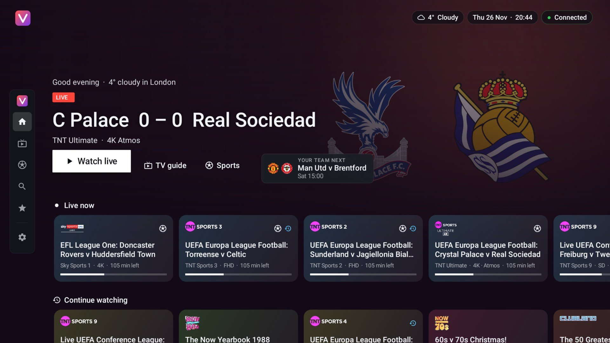
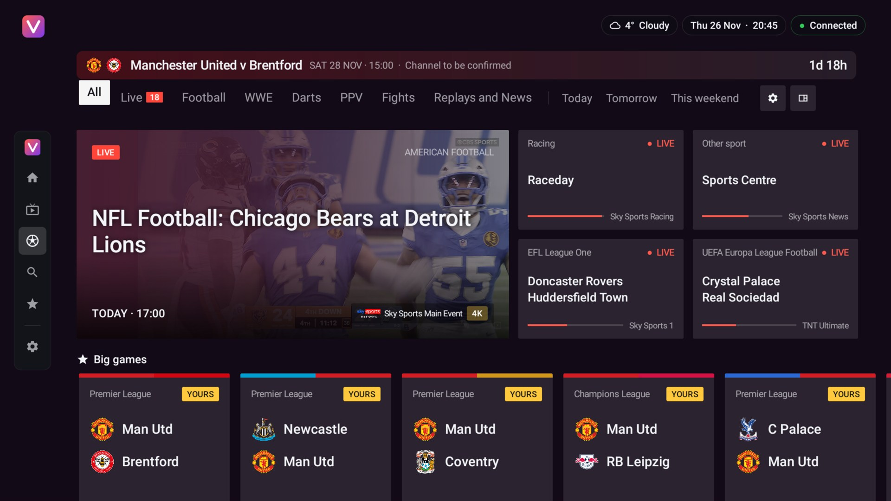
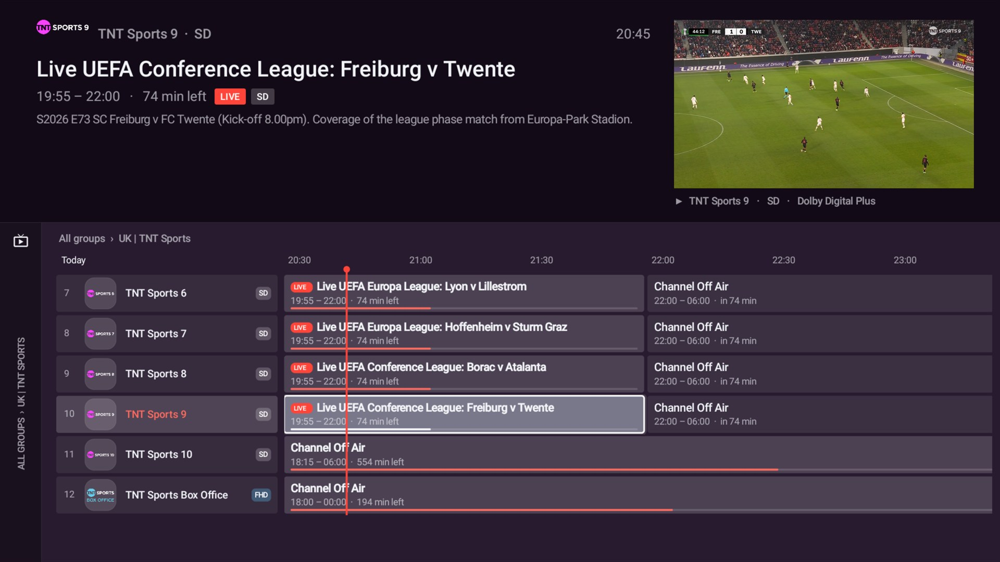
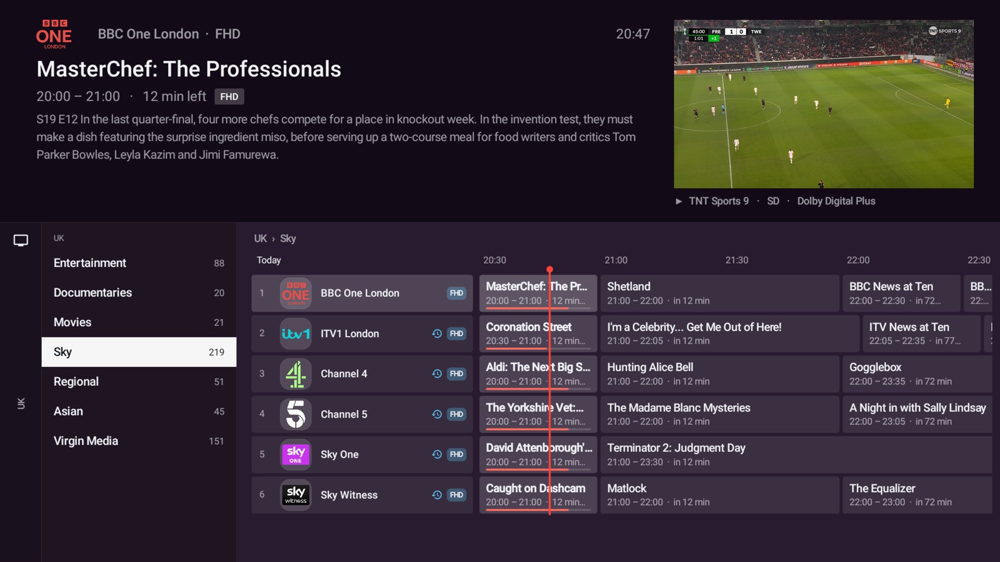
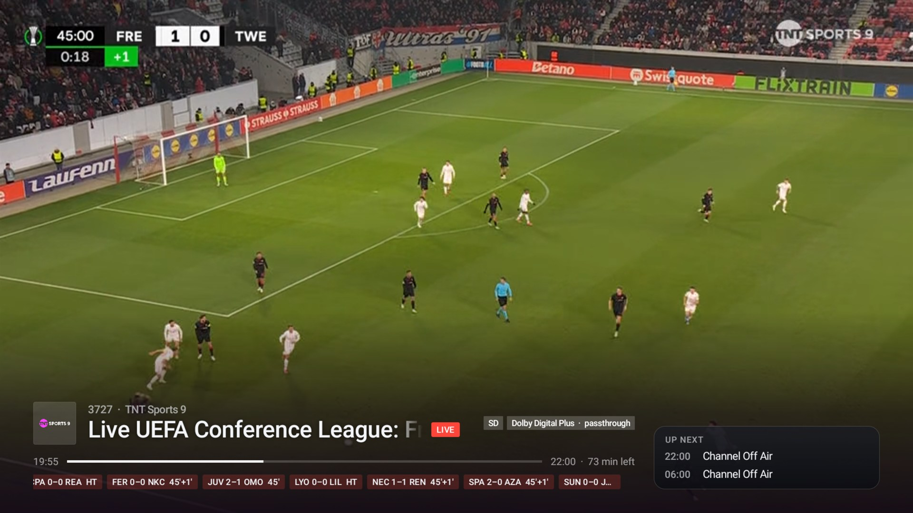
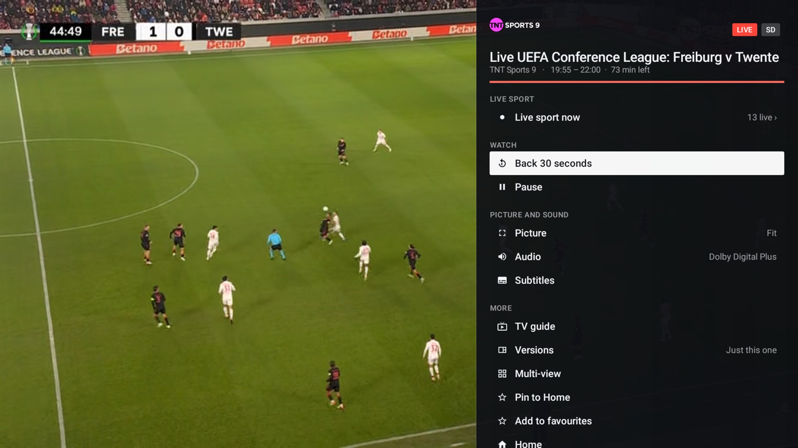
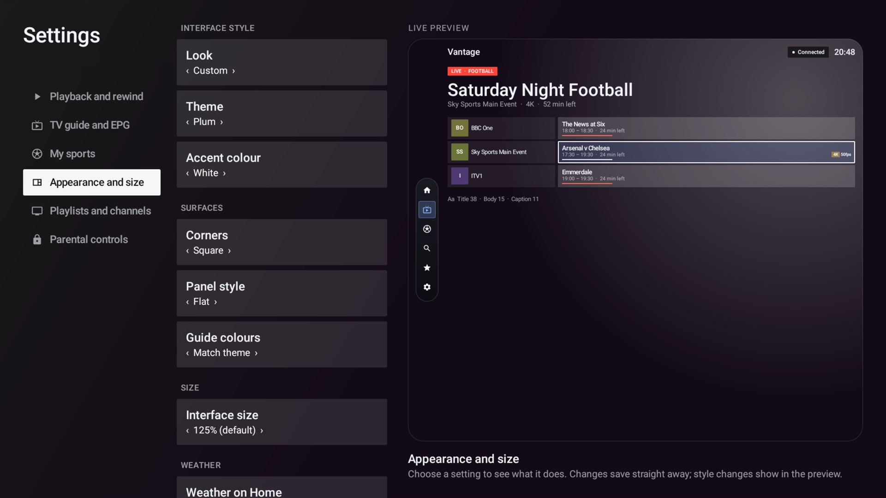

<h1 align="center">Vantage</h1>

  <b>Live TV, a proper TV guide and your own Sports Hub — made for the big screen.</b> 
  Built for the NVIDIA Shield. Works on Google TV, Android TV and Fire TV.

  <a href="https://github.com/charleswoosnam01-collab/vantage/releases/latest/download/Vantage.apk"><b>⬇ Download Vantage</b></a>
  &nbsp;·&nbsp; Downloader code <b>2785143</b>
  &nbsp;·&nbsp; <a href="https://github.com/charleswoosnam01-collab/vantage/releases/latest">What's new</a>

  

---

## What is Vantage?

Vantage is a TV app for watching live channels from your own IPTV subscription. It turns a long list
of channels into something that feels like proper TV: a Home screen that shows what's on right now,
a fast TV guide, and a Sports Hub that knows which teams you follow and which channel is showing them.

It's quick to change channel, it picks the best working copy of every channel for you, and it plays
4K, HDR, Dolby Atmos and DTS at full quality.

> **Vantage is a player. It doesn't come with any channels.** You need your own IPTV subscription
> with an **Xtream Codes login** (a server address, username and password from your provider).

---

## A look around

### Home — what's on, at a glance
A greeting and the weather, the big live game with a one-press **Watch live**, your team's next match,
then **Live now**, **Continue watching** and your favourites.

### Sports Hub — your teams first

Live sport playing in the big tile, a countdown to your team's next game, and every big fixture with
its channel. Filter by Football, WWE, Darts, Fights, PPV, or Today / Tomorrow / This weekend. Live
scores and goal alerts pop up while you watch something else.

### TV guide — fast, with a live preview

Scroll the evening's programmes while the channel you're on keeps playing in the corner. Rest on a
channel and the preview switches to it. Catch-up and rewind where your provider supports them.

Channels are sorted into tidy groups — Entertainment, Documentaries, Movies, Sports and more — with
one entry per channel, not five copies of the same one.

### Watching — everything you need, nothing in the way

Press Info for the programme, time left, picture and sound details, live scores from other games and
what's on next. Press OK for the side menu: rewind, live sport now, audio and subtitles, versions,
multi-view (up to four screens) and favourites.

### Make it yours

Twelve themes, accent colours, square or rounded corners, interface size, a kids lock, spoiler-free
scores and more — with a live preview as you change them.

---

## Why it feels better

- **Just change channel and it works.** If a channel's copy is switched off at your provider, Vantage
  quietly moves to a working one in about a second. No pickers, no "this channel isn't working".
- **Quick starts.** Most channels show a picture in under a second, and a clean first frame — no
  blocky start.
- **Rides out a shaky provider.** Short pauses from the provider are absorbed instead of freezing.
- **Sport, sorted.** Your teams' fixtures, live scores, replays and the right channel (Sky Sports and
  TNT first, 4K when there is one).
- **Picture and sound as they should be.** 4K, HDR, Dolby Atmos and DTS go straight to your TV or
  amplifier.
- **Updates itself.** New versions are offered on the Home screen — one press to install.

---

## Install

### With Downloader (easiest)

1. On your TV, install **Downloader** (by AFTVnews) from the app store.
2. Allow it to install apps:
   - **Android TV / Google TV / Shield:** Settings › Apps › Security & restrictions › Unknown sources › turn on **Downloader**.
   - **Fire TV:** Settings › My Fire TV › Developer options › Install unknown apps › turn on **Downloader**.
3. Open Downloader, enter the code **2785143** and press Go.
   *(or type the full address: `https://github.com/charleswoosnam01-collab/vantage/releases/latest/download/Vantage.apk`)*
4. When it's downloaded, choose **Install**, then **Done**. Downloader offers to delete the file; you can.

Or download it directly: **[Vantage.apk](https://github.com/charleswoosnam01-collab/vantage/releases/latest/download/Vantage.apk)**

### First launch

1. **Sign in** with your provider's server address, username and password.
   The address usually looks like `http://something.com:8080` — include the port if they gave you one.
2. **Pick your teams** — add your teams, leagues and sports, then press Back. They go to the top of
   your Sports Hub. Change them any time in Settings › My sports.
3. The first load fetches your channel list and TV guide; give it a minute.

Your login stays on your TV. To change it: Settings › Playlists and channels › Change login.

### Updating

Vantage updates itself: when there's a new version it asks you on the Home screen, or check any time
in Settings › Playlists and channels › Check for updates. Choose **Update** and Android shows its
install screen. The first time, Android asks you to let Vantage install updates — turn on
"Allow from this source", press Back and choose Update again. Your login and settings are kept.

On version 1.0.0? Enter the Downloader code (**2785143**) once more to get the latest version.

---

## Problems?

- **"Couldn't reach that server"** — check the address and port exactly as your provider sent them.
- **"Username or password wasn't accepted"** — check them, or ask your provider.
- **"This channel is off at your provider right now"** — your provider has that channel switched off;
  try another, or check back later. The Connected pill on Home says *Provider having problems* when
  lots of channels are off at once.
- **Sports Hub or groups look empty** — wait a minute after first sign-in, then Settings ›
  Playlists and channels › Update playlist now.
- Anything else: let me know which screen it was and what you pressed.

Vantage doesn't provide, host or sell any channels or content. Channel names and logos shown in
the screenshots belong to their owners and come from the user's own provider.

